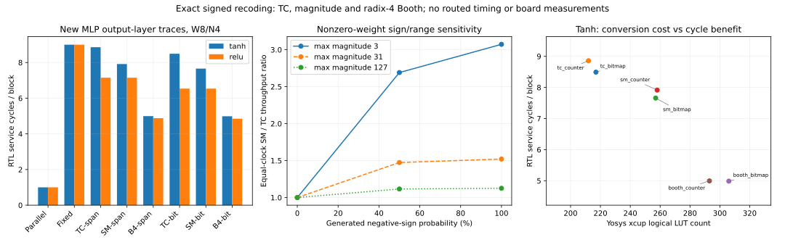

# Exact signed-digit dot-product recoding

An executed synthesizable RTL comparison of two's complement, exact magnitude recoding and radix-4 Booth, with bitmap/counter controls and newly trained Tanh/ReLU MLP hidden-layer traces.

## Reproduce

```bash
python3 run_project.py
```

Linux x86-64, Python 3.12.14, pinned local Icarus/YoWASP tools and analysis dependencies. Initial bootstrap needs HTTPS access. Reproduction trains six checkpoints and regenerates the full simulation, synthesis, validation and report pipeline. See [toolchain](TOOLCHAIN.md).

## Measured findings

For W8/N4 on all three new Tanh checkpoints and 360 fixed test images each:

- TC bitmap: **8.491829 cycles/block**; SM bitmap: **7.658252**, or **1.1088x equal-clock throughput**.
- SM/TC throughput per logical LUT: **0.9363x**; SM/Booth throughput: **0.6513x**. Conversion/storage cost and the stronger baseline must be considered.
- ReLU TC/SM cycles are identical, so SM has no cycle gain on this control. Parallel arithmetic remains faster in cycles.
- All eight mechanisms preserve the same quantized integer dots and predictions. Training supplies workload realism; it is not a new quantization algorithm.

Validation: 726 RTL/netlist runs, 3,700,388 checked outputs, eleven Python tests, eight bounded W3/N2 checks, five detected compiled mutations, 45 synthesis/readback configurations and 22 generic-netlist replays. No inferred latches.

These are RTL service cycles and actual logical synthesis metrics, **not UVM execution, physical FPGA timing, power, board throughput or end-to-end inference speedup**. Small-MLP evidence and selective literature review do not establish thesis/conference submission readiness.

## Deliverables

[Specification](SPEC.md), [RTL](rtl), [executed verification](VERIFICATION.md), [report](REPORT.md), [training source](train_models.py), [models/history](results), [comparison](results/comparison.csv), [raw block outputs](results/application_blocks.csv), [resource summaries](results/resources.json), [audit](results/validation.json), compact logs/netlists, pinned dependencies and content manifest.


