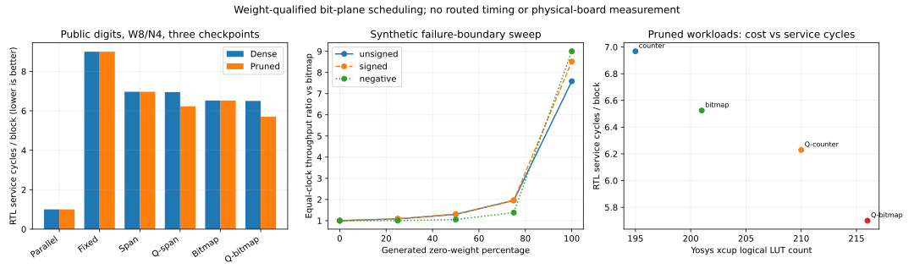

# Weight-qualified bit-plane dot products

A complete reproducible signed-RTL experiment extending shared zero-plane scheduling with zero-weight lane qualification. It asks whether the saved service cycles justify extra control logic, using an equally qualified counter-span baseline and parallel arithmetic controls.

## Reproduce

```bash
python3 run_project.py
```

Linux x86-64, Python 3.12.14; pinned Icarus/YoWASP and analysis packages bootstrap locally. Initial network access is required for dependencies. See [toolchain](TOOLCHAIN.md). The run overwrites generated results and regenerates the full predefined experiment.

## Measured findings

For W8/N4 on all three reused pruned checkpoints and 360 fixed public test images each:

- Bitmap qualification: 6.524479 → 5.699873 cycles/block, **1.1447x equal-clock throughput**.
- Versus an equally qualified counter: **1.0929x**, with 216 versus 210 logical LUTs; throughput/LUT proxy **1.0625x**.
- Dense nonzero weights have no cycle improvement; surviving all-minus-one activations mostly erase skipping. Parallel arithmetic remains faster in cycles.
- Scheduling preserves every replayed integer dot result and prediction. No new models are trained.

Validation: 484 RTL/netlist runs, 5,419,264 checked outputs, ten Python tests, six bounded W3/N2 SAT checks, three detected functional mutations, 33 synthesis/readback configurations and sixteen generic-netlist replays. No inferred latches.

These are simulated core cycles and actual logical synthesis counts, **not routed Fmax, physical board performance, UVM execution, or end-to-end inference speedup**. The public classifier is small and shares the prior project's data/checkpoints. Known combined weight/bit sparsity prior art is acknowledged; no novelty or publication-readiness claim is made.

## Deliverables

- [Specification](SPEC.md), [RTL](rtl), [executed verification](VERIFICATION.md), [report](REPORT.md), [related work](RELATED_WORK.md).
- [Simulation records](results/simulation.json), [public raw blocks](results/application_blocks.csv), [per-image cycles](results/image_cycles.csv), [comparison](results/comparison.csv).
- [Resources](results/resources.json), retained netlists/logs in `results/`, [result audit](results/validation.json), `MANIFEST.json` content hashes.
- [Development decisions](DEVELOPMENT.md) and pinned, attributed `fixtures/`.


